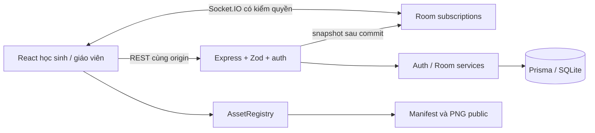

# Kiến trúc BYTE ACADEMY

## Workspace

- `apps/web`: React 19, Vite 7, TS strict, Tailwind 4, CSS Modules, Motion, Zustand, React Router. app cấu hình route; pages màn hình; components UI; features/rooms luồng phòng; games adapter Phaser; stores/hooks/services/styles/assets có trách nhiệm riêng.
- `apps/server`: Node, Express 5, Socket.IO, Prisma 6, SQLite. routes là transport, services chứa logic, validation Zod, middleware quyền/origin, database Prisma/CLI, config env, socket realtime. modules dành cho domain gameplay sau này.
- `packages/shared`: types, lesson definitions, events, snapshot, scoring contracts và hai state machine; build trước consumer.
- `public/assets`: source duy nhất. scripts/tests/docs chứa công cụ, kiểm thử và quy chuẩn.

## Luồng dữ liệu

Vite bind LAN và proxy `/api`, `/socket.io` sang 3001. Production Express phục vụ web/dist, API và Socket.IO cùng origin. Không mount workspace/Prisma/file học sinh. Health thực thi SELECT 1.

## Lưu trữ

Teacher → Classroom → Student. Teacher → Room → RoomSession → Lesson. RoomMember nối Student/Room và hash token. Attempt nối Student/Lesson/RoomSession tùy chọn; Result một-một Attempt. Progress unique student/lesson, Achievement unique student/reward. AuthSession có hạn và hash token. Foreign keys SQLite được Prisma quản lý.

Seed sáu intro giữ ID ổn định available=false và 12 bài chuột M03 available=true. Tên tự khai vào phòng tạo Student riêng, không tự ghép học sinh có cùng tên để tránh mạo nhận. API M03 kiểm log thao tác rồi mới ghi kết quả. Schema hỗ trợ chức năng sau không có nghĩa chức năng đã mở.

## Quyền và đồng bộ

Mật khẩu bcrypt cost 12, session randomBytes(32), DB lưu hash SHA-256. Cookie HttpOnly, SameSite Strict, Secure tùy HTTPS. Kiểm owner ở backend trên lớp/phòng/báo cáo. Socket subscribe kiểm teacher hoặc membership; không chỉ tin room code. Snapshot chỉ có số lượng, không roster. Quyền socket kiểm lại mỗi 30 giây. Phiên 8 giờ. Rate limit login/join, 60 thành viên/phòng, 20 subscription/connection.

State update có revision và transaction để chặn cập nhật cũ. Join đọc state/tạo member trong transaction. Broadcast sau commit, DB là nguồn thật. Reconnect subscribe lại và nhận snapshot mới. MemberCount là số đã tham gia, không phải số online. Game state cá nhân tách khỏi room state server.

## Asset và giao diện

Registry cache manifest/promise ảnh, timeout 20 giây, retry sau lỗi, lookup atlas ID/sprite name. Phân khu preload atlas riêng, loading/error có thật. Home chỉ tải hình cần hiển thị. Phaser/admin lazy-load. Gallery không bundle trong production.

Hai concept đã đọc: cream, Byte, banner pastel, bốn thẻ phân khu. Nunito Vietnamese self-host, navy text, label form, focus visible, native dialog, reduced motion, mobile 390px và desktop. Không gắn sao/tiến độ giả.

## Phiên bản

Vite 7/Prisma 6 được giữ ở nhánh ổn định cho SQLite, lockfile khóa bản thực cài. Tham khảo [Tailwind Vite](https://tailwindcss.com/docs/installation/using-vite), [Prisma 6 migration](https://www.prisma.io/docs/orm/v6/prisma-migrate/getting-started), [Vite 7 migration](https://v7.vite.dev/guide/migration). Vitest 4.1.12 và deepmerge-ts override 8 xử lý các advisory được phát hiện. Chạy lại migration/generate/tests/build khi đổi dependency.

## Student UI M02

`StudentDataProvider` tải lesson từ `/api/lessons` và snapshot cá nhân từ `/api/student/overview`; cập nhật sau join, khi tab nhận focus hoặc bấm thử lại. Lỗi kết nối xóa snapshot cũ và hiện trạng thái lỗi, không thay bằng tiến độ thành công. `features/student/learning.ts` tính trạng thái phân khu, sao theo reward ID và danh sách lesson gợi ý dùng chung cho Home/Missions. Không lưu tiến độ ở localStorage.

`styles/student.css` giữ token pastel, layout desktop, breakpoints và reduced motion. AtlasRegistry vẫn là nguồn URL duy nhất; Home chỉ nạp sprite cần dùng, mỗi phân khu preload nhóm tương ứng. `services/audio.ts` quản lý một âm thanh tại một thời điểm; thay hướng dẫn, mute hoặc unmount sẽ dừng phát. Preview dùng Game UI chung và lesson definition, không copy JSX theo bài.

## Gameplay chuột M03

`packages/shared/src/mouse.ts` chứa 12 lesson, thứ tự cấp độ và reducer MouseRun thuần dùng ở cả scene lẫn server. `games/mouse/scene.ts` chỉ vẽ Phaser và nhận native pointer/wheel; `MouseGamePage.tsx` dùng React cho sidebar/HUD/audio/modal/countdown/pause. Adapter engine đợi texture hoàn tất, lazy import Phaser và destroy khi unmount. Loader dùng HTMLImageElement để giữ CSP img-src self/data, không cần mở blob.

`routes/games.ts` nhận thao tác qua service API hiện tại, kiểm cookie qua services/student.ts, replay và ghi transaction. PracticeIdentity bổ sung danh tính ẩn danh có hạn; không thay DB vận hành hoặc roster cũ. RoomSession.controlLog và Attempt.pauseLog là lịch sử điều khiển có thời gian server. Result giữ audit log riêng, báo cáo chỉ select các thống kê cần thiết. Migration `20261020170000_mouse_gameplay` chỉ bổ sung cột/bảng, không reset dữ liệu.

Bài `mouse-intro` cũ được đánh dấu retired: giữ trong DB cho phòng/kết quả cũ, không trả trong danh sách lesson công khai và không tính vào 12 bài luyện chuột hiện hành.

## Luyện gõ M04

`shared/typing.ts` chứa bài, bản đồ QWERTY/ngón, PhysicalKeyboard, TypingRun và công thức; `shared/vietnamese.ts` chứa engine âm tiết Telex/VNI, edit theo selection, NFC/grapheme và CompositionGate. Không dùng listener toàn cục từ thư viện bộ gõ. `games/typing/TypingGamePage.tsx` lazy-load, tái dùng sprite/modal/button/progress/audio; `VirtualKeyboard.tsx` render React/CSS, không dùng atlas bàn phím tĩnh để nhận phím. `useTypingRoom` subscribe snapshot theo revision, dừng khi mất kết nối. Không phụ thuộc Phaser cho luyện gõ.

`routes/typing.ts` tạo config cố định theo lesson (tên cá nhân được validate), kiểm session/cookie, replay log bằng cùng reducer, tính thời gian bỏ pause và lưu transaction. `Attempt.typingConfig` + Result cpm/wpm/longestStreak/errorCount được bổ sung bởi migration `20261021080000_typing_modules`; không reset dữ liệu. Log text chỉ lưu bản ổn định, không chấm compositionupdate. Báo cáo giữ quyền owner và không expose log. Start/pause/snapshot trả giờ máy chủ để tránh dùng đồng hồ hệ điều hành máy học sinh làm nguồn thời gian.

## M05 — Mô phỏng có trạng thái máy chủ

`shared/vfs.ts`: cây ID/metadata, thao tác transaction bất biến, clone subtree, trash/restore, bounded undo, navigation/query/sort. `shared/desktop.ts`: window geometry/lifecycle/focus/z-index. `shared/simulation.ts`: 25 lesson, snapshot definition theo lượt, reducer domain command, mục tiêu/score dùng chung. Không gọi Node fs/File System Access API trong engine hoặc frontend.

`games/simulation` lazy-load React: FileExplorer (tree/grid/dialog/menu/drag/keyboard), ComputerDesktop (pointer capture + preview hình học + commit), ScenarioQuiz (đáp án/trạng thái đóng cửa sổ), SimulationGamePage (cookie API, pause, phòng, kết quả). Dùng registry/sprite/component game/audio hiện có, không ảnh screenshot làm gameplay.

`routes/simulation.ts` + `validation/simulation.ts` xác thực schema, cookie owner, lesson/room/lifecycle, expected revision. Mỗi command được server áp dụng vào snapshot đã lưu, updateMany so revision và ghi transaction; client không gửi cây tệp hoặc đáp án đã đạt. Result tính trực tiếp snapshot đó, không dựa điểm client. Snapshot definition cố định khi tạo lượt để bảo toàn luật của bài dở. GET snapshot theo owner và POST start trả lại lượt chưa hoàn thành đúng lesson/session để resume. Cookie practice cũ dùng lại; không localStorage VFS hoặc điểm. Migration `20261021100000_simulation_modules` chỉ thêm Attempt.simulationState + simulationRevision; không reset dữ liệu.

Native drop chỉ nhận ID do dragStart nội bộ đặt, không đọc File/đường dẫn hệ điều hành. Reducer vẫn kiểm ancestor/collision trước mọi thay đổi. Nếu request lỗi, client đọc lại snapshot; nếu không xác nhận được thì khóa thao tác cho tới khi reload trạng thái. Kết nối/phòng giữ Socket.IO revision như M03–04. Kết quả owner được tổng hợp vào overview/report hiện có, raw snapshot audit không xuất trong report.

## Fit viewport cho các trang thực hành

Các root MouseGamePage, TypingGamePage, SimulationGamePage phủ viewport thật bằng fixed inset/100dvh; Student shell được ẩn khi thực hành. CSS chung tại styles/practice.css giữ header và nút nộp, để nội dung cuộn trong panel khi không đủ diện tích. Màn Chuột dùng nền cảnh full viewport và menu nổi theo concept; không dùng ảnh concept làm gameplay, không khóa root 16:9.

Canvas Chuột giữ logic 960×560, Phaser Scale.NONE, CSS scale đồng nhất theo ResizeObserver của vùng chơi; native pointer chuyển bằng bounding rect. Desktop giữ logic 1000×600, chia delta kéo/resize cho scale đầu gesture và hủy gesture khi scale đổi. FullscreenButton dùng Fullscreen API sau tương tác, có fallback F11. Không đổi schema/backend scoring. Xem PRACTICE_SCREEN_VERIFICATION.md.
